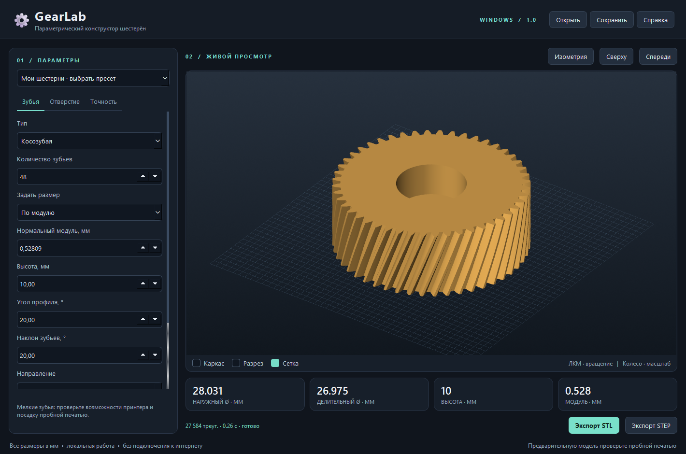

# GearLab

Отдельное приложение Windows для создания параметрических 3D-моделей шестерён с живым просмотром и экспортом STL/STEP. Интерфейс на русском языке. Работает локально, без браузера и подключения к интернету.



## Скачать и запустить

Откройте **Releases** этого репозитория, скачайте `GearLab-Windows.zip`, распакуйте весь архив и запустите `GearLab/GearLab.exe`. Сохраните папку `_internal` рядом с EXE. Установка Python для готовой сборки не нужна.

Требования: Windows 10/11 x64 и графический драйвер с поддержкой OpenGL. Приложение проверено на Windows-компьютере разработчика; совместимость со всеми конфигурациями не гарантируется.

## Возможности

- Прямозубые, косозубые, шевронные и внутренние шестерни; зубчатые рейки; предварительные конические профили и червяки-винты.
- От 6 до 300 зубьев, размер по нормальному модулю или наружному диаметру, высота, угол профиля, наклон и направление зубьев, боковой зазор.
- Круглое, D-образное или шестигранное отверстие; ступенчатая расточка с заданной глубиной.
- Вращение, масштабирование, каркас и разрез модели. Разрез меняет только просмотр.
- STL для печати, STEP для CAD, сохранение и восстановление параметров проекта.
- Примеры 12T, 36T и 48T, включая ступенчатое отверстие Ø2,8 / Ø10 × 5 мм.
- Проверка размеров, замкнутости сетки и валидности тела перед экспортом.

Все размеры в миллиметрах. [Подробная инструкция и ограничения](README_RU.md).

## Разработка

Python 3.12 x64, PowerShell:

```powershell
python -m venv .venv
.venv\Scripts\python -m pip install -r requirements.txt
.venv\Scripts\python main.py
```

Измените число в поле и подтвердите Enter либо используйте стрелки: 3D-модель обновится автоматически. ЛКМ вращает модель, колесо меняет масштаб, Shift + ЛКМ сдвигает камеру.

## Проверка и сборка EXE

```powershell
.venv\Scripts\python -m pytest tests -q --basetemp=build-test-tmp
.venv\Scripts\python -m PyInstaller --noconfirm GearLab.spec
.venv\Scripts\python package_release.py --output release
```

Готовые файлы: `release/GearLab-Windows.zip`, `release/GearLab-source.zip` и `release/SHA256SUMS.txt`. Для проверки самого EXE:

```powershell
.\dist\GearLab\GearLab.exe --smoke-test build\smoke
```

Режим проверки открывает окно, меняет пресеты, экспортирует STL и STEP, сохраняет снимки экрана и отчёт, затем закрывает приложение. Для него требуется интерактивный рабочий стол. Автотесты геометрии можно выполнить отдельно: `python -m pytest tests/test_geometry.py -q`.

GitHub Actions проверяет геометрию и собирает Windows-архив. Тег вида `v1.0.0` публикует собранные архивы в GitHub Release.

## Ограничения модели

Цилиндрические профили основаны на эвольвенте. Подрезание инструментом, корневая галтель, коррекция профиля и контакт пары не рассчитываются. Коническая модель строится из масштабированных сечений; червяк является трапецеидальным винтом без расчёта ответного колеса. Внутренние передачи требуют отдельной проверки интерференции. Это инструмент построения геометрии, а не аттестация передачи для работы под нагрузкой.

В примерах углы профиля и наклона 20° приняты как исходное допущение. Перед изготовлением проверьте геометрию сопряжённой детали, допуски и пробную печать.

## Устройство проекта

| Файл | Назначение |
| --- | --- |
| `gearlab/parameters.py` | Параметры, производные размеры, проверки, пресеты |
| `gearlab/geometry.py` | Профили, сетка, STL |
| `gearlab/cad_export.py` | Криволинейные тела OCCT и STEP |
| `gearlab/gui.py` | PySide6 и интерактивный VTK-просмотр |
| `tests/` | Геометрия, экспорт, работа интерфейса |
| `GearLab.spec` | Автономная сборка PyInstaller |

## Лицензия

Исходный код GearLab: [MIT](LICENSE). Qt/PySide6, VTK, NumPy, OCP и OCCT имеют собственные лицензии; тексты включаются в Windows-архив. Дополнительные тексты находятся в `third_party_licenses/`. Библиотеки поставляются динамически, отдельно от EXE.
